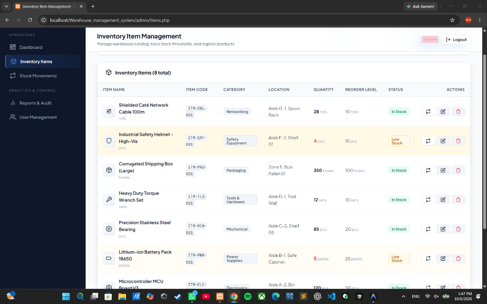

# Warehouse Management System (WMS Pro)

A lightweight, enterprise-grade, highly reliable **Warehouse Management System** built with **PHP 8+**, **MySQL 8+**, **PDO**, **PHP Sessions**, **HTML5**, **CSS3**, and **Vanilla JavaScript**.

---

## 📸 System Screenshots

### Inventory Item Management & Live Ledger


---

## 🚀 Key Features

* **Real-time Inventory Tracking**: Track items, exact stock quantities, locations, and low-stock reorder thresholds.
* **Item Icon Visual System**: Built-in, clean, lightweight SVG icons assigned to each item for intuitive warehouse identification.
* **Strict Stock Movement Ledger**: High-concurrency safe `Stock IN` and `Stock OUT` operations powered by **PDO database transactions** and **row-level locking** (`SELECT ... FOR UPDATE`).
* **Negative Stock Prevention**: Disallows issuing more items than current stock on hand (`OUT > current stock` rejected with rollback).
* **Role-Based Access Control (RBAC)**:
  * **Admin**: Complete system control — dashboard KPIs, item management, stock movements, reporting & printouts, user administration.
  * **User (Operator)**: Read-only access — catalog browsing, search/filter, item specifications, and movement history.
* **Print-Ready Audit Reports**: Filter by item, category, movement type, and date range with automated net balance calculation and `@media print` optimized layout.
* **Enterprise Security Standards**:
  * CSRF Protection with verified session tokens on all state-changing `POST` requests.
  * XSS Prevention via context-aware HTML escaping (`e()`).
  * SQL Injection immunity through parameterized PDO prepared statements.
  * BCrypt password hashing (`password_hash` / `password_verify`).
  * Hardened Session Cookies (`HttpOnly`, `SameSite=Lax`, secure detection).
  * Direct file protection (`.htaccess`) preventing unauthorized access to configs and database schemas.

---

## 🛠️ Technology Stack

* **Backend**: PHP 8.0+ / 8.2+ with PDO & PDO_MySQL
* **Database**: MySQL 8.0+ / MariaDB 10.4+
* **Frontend**: Pure Semantic HTML5, Custom CSS3 Design System, Vanilla JavaScript
* **Dependencies**: Zero external heavy frameworks (no Laravel, Tailwind, React, or jQuery required).

---

## 📂 Project Directory Structure

```text
Warehouse_management_system/
│
├── admin/
│   ├── dashboard.php      # Admin KPI overview & low stock alerts
│   ├── items.php          # Inventory item CRUD & validations
│   ├── movements.php      # Stock IN/OUT transactions & ledger
│   ├── reports.php        # Audit reports, summary, & print view
│   └── users.php          # User management & role assignment
│
├── api/
│   └── items.php          # Authenticated JSON items endpoint
│
├── assets/
│   ├── css/
│   │   └── style.css      # Professional, clean, responsive UI theme
│   └── js/
│       └── app.js         # Navigation, modals, alerts, and interactions
│
├── config/
│   ├── .htaccess          # Web access forbidden
│   ├── config.php         # Application constants & dynamic path resolution
│   └── database.php       # Resilient PDO connection with multi-port fallback
│
├── database/
│   ├── .htaccess          # Web access forbidden
│   ├── init_db.php        # CLI database installer script
│   └── schema.sql         # SQL schema with seed accounts & inventory
│
├── includes/
│   ├── auth.php           # Authentication & role guard middleware
│   ├── footer.php         # Common footer & script loader
│   ├── functions.php      # Security helpers & SVG icon library
│   ├── header.php         # Navigation header & topbar
│   ├── init.php           # Core application bootstrapper
│   └── nav.php            # Dynamic role-based sidebar
│
├── .htaccess              # Root security & directory browse prevention
├── index.php              # Intelligent entry-point router
├── login.php              # Secure login interface
├── logout.php             # Session invalidation & logout
└── README.md              # Documentation
```

---

## 🔑 Default Accounts (Development / Demo)

| Role | Username | Password | Access Level |
| :--- | :--- | :--- | :--- |
| **Admin** | `admin` | `admin123` | Full control: items, movements, reports, users |
| **User** | `user` | `user123` | Read-only catalog, item details, and dashboard |

> *Note: For security reasons, the login input fields are deliberately not pre-filled. Credentials are displayed on the login card for easy testing.*

---

## 💻 Installation & Setup

### 1. Requirements
* XAMPP (Apache + MySQL/MariaDB) or any LAMP/LEMP/cPanel hosting with PHP 8+ and MySQL 8+.

### 2. Database Initialization
Run the built-in migration script from the project root:
```bash
php database/init_db.php
```
Or import `database/schema.sql` directly into phpMyAdmin or MySQL client.

### 3. Access in Browser
Navigate to your local server:
```text
http://localhost/Warehouse_management_system/
```
The application will automatically detect its directory path and route you to the login screen.

---

## 📄 License

This project is licensed under the MIT License - see the [LICENSE](LICENSE) file for details.

